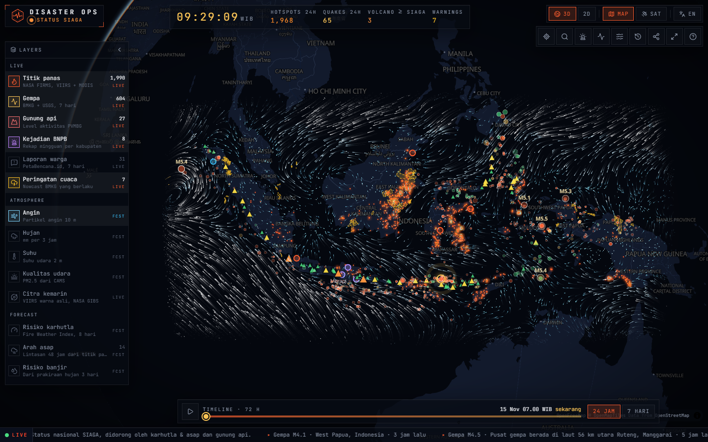
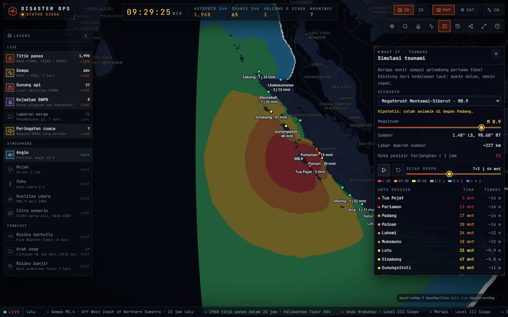
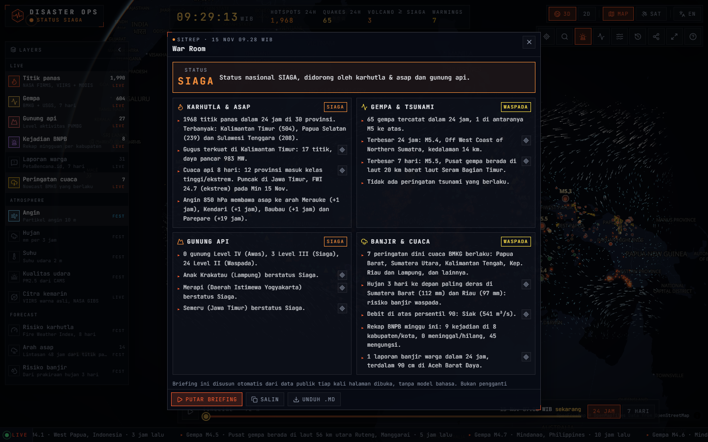
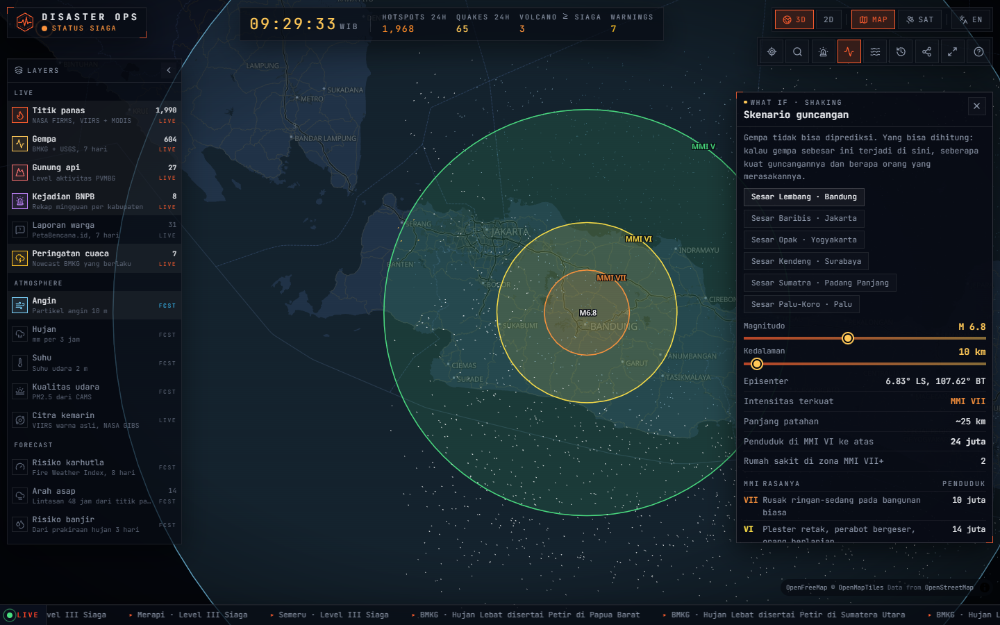
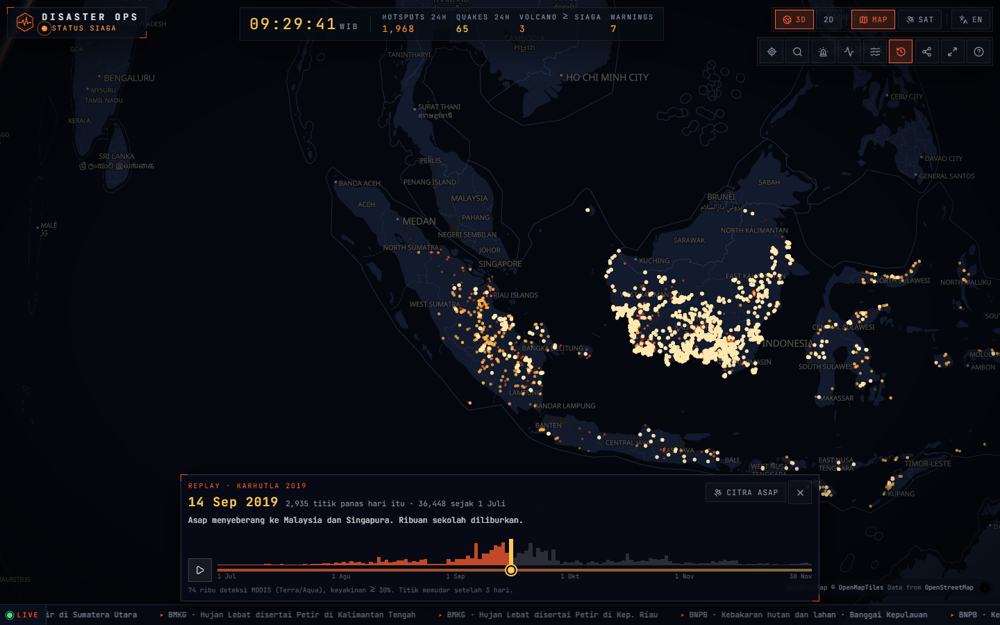

# Disaster Ops

[](https://github.com/Avalon2222/disaster-ops/actions/workflows/ci.yml)
[](https://github.com/Avalon2222/disaster-ops/actions/workflows/prakiraan.yml)
[](https://nextjs.org)
[](https://maplibre.org)
[](LICENSE)

> **When the ground shakes and the sky burns, this is the room that stays awake.**
> War room bencana Indonesia di satu layar: titik panas karhutla dari satelit, gempa BMKG + USGS, status gunung api,
> kejadian BNPB, peringatan dini cuaca, angin yang benar-benar bergerak, prakiraan risiko karhutla dan banjir 8 hari,
> simulasi waktu tiba tsunami, skenario "kalau M7 di sini", briefing harian otomatis, dan putar ulang karhutla 2019.
> Semuanya live, semuanya dari data publik.

**Live:** https://disaster-ops.vercel.app



<p align="center">
  
  
</p>
<p align="center">
  
  
</p>

## 🇬🇧 In English

**A live disaster war room for Indonesia, rendered on a WebGL globe.** One of the most hazard-exposed countries on
Earth publishes a surprising amount of open data; it just lives on a dozen different websites. Disaster Ops pulls it
into one dark console that refreshes itself.

- **Watch it live.** Fire hotspots from three satellites (NASA FIRMS: VIIRS NOAA-20/21 + MODIS) every 10 minutes,
  earthquakes merged from BMKG InaTEWS and USGS every minute (with felt reports and shakemaps), volcano alert levels
  from PVMBG, BNPB's weekly incident recap, crowdsourced flood reports, and BMKG's active weather warnings as polygons.
- **See the atmosphere move.** Thousands of wind particles advected by the forecast, plus rain, temperature, PM2.5,
  and yesterday's true-color satellite pass. Drag the timeline 72 hours ahead.
- **Look ahead, honestly.** Fire danger from a full Canadian Fire Weather Index run (the system BMKG uses), smoke
  drift along 850 hPa winds, flood risk from 3-day rain totals and GloFAS river discharge on 22 rivers. Earthquakes
  are **not** predicted: you get faults, megathrusts, every M6+ since 1900, and BNPB's InaRISK hazard maps instead.
- **Ask "what if".** Click anywhere for an **M7 shaking scenario**: intensity rings, people exposed per MMI class
  (WorldPop), hospitals inside the damage zone, and a road route to the nearest one outside it. Or drop a **tsunami
  source** and watch the wavefront cross the real seafloor, with arrival times for ~190 coastal towns and a route to
  high ground. Eleven presets, from Aceh 2004 to a hypothetical Sunda Strait megathrust.
- **Get briefed.** The War Room writes a daily SITREP from the live feeds (no language model, just rules and numbers),
  rates each hazard, and can fly you through it as a cinematic briefing.
- **Remember 2019.** Replay 74 thousand fire detections from the worst haze season of the decade, day by day, over
  that day's satellite image.

Built with Next.js 16, TypeScript, Tailwind 4 and MapLibre GL (globe projection). Forecast snapshots are rebuilt every
six hours by GitHub Actions; static layers are prepared with Python. Bilingual (ID/EN), keyboard-driven, tested in a
real browser at 360, 390, 412 and 1440 px. *The rest of this README is in Indonesian.*

## Mengapa

Informasi bencana Indonesia itu terbuka, tapi tercecer: titik panas di NASA, gempa di BMKG, gunung api di MAGMA,
kejadian di BNPB, cuaca di tempat lain lagi. Waktu sesuatu terjadi, orang membuka lima tab dan tetap gak dapat
gambaran utuhnya. Proyek [ring-of-fire-pulse](https://github.com/Avalon2222/ring-of-fire-pulse) dan
[burning-archipelago](https://github.com/Avalon2222/burning-archipelago) sudah memetakan sebagian, tapi masih terasa
seperti laporan. Disaster Ops adalah versi "ruang komando"-nya: satu globe, semua bahaya, diperbarui sendiri, dan bisa
ditanya *"kalau terjadi di sini, gimana?"*.

## Lapisan

| # | Lapisan | Jenis | Sumber singkat |
|---|---|---|---|
| 1 | Titik panas 24 jam / 7 hari, hanya yang di daratan Indonesia | live, 10 menit | NASA FIRMS (VIIRS NOAA-20/21, MODIS) |
| 2 | Gempa 7 hari, lengkap dengan MMI dirasakan dan shakemap | live, 1 menit | BMKG InaTEWS + USGS |
| 3 | Gunung api: 69 gunung dengan Level I-IV | live, 30 menit | MAGMA Indonesia (PVMBG) |
| 4 | Kejadian bencana mingguan per kabupaten: korban, pengungsi, kronologi | live, 15 menit | BNPB |
| 5 | Laporan warga 7 hari (banjir, kebakaran, angin) | live, 15 menit | PetaBencana.id |
| 6 | Peringatan dini cuaca yang sedang berlaku (poligon) | live, 5 menit | BMKG nowcast (CAP) |
| 7 | Angin 10 m sebagai partikel bergerak | prakiraan 72 jam | Open-Meteo |
| 8, 9, 0 | Hujan per 3 jam, suhu, PM2.5 | prakiraan 72 jam | Open-Meteo, CAMS |
| - | Citra warna asli kemarin | harian | NASA GIBS (VIIRS) |
| Q | Risiko karhutla: Fire Weather Index di 307 sel darat | prakiraan 8 hari | dihitung dari Open-Meteo |
| E | Arah asap: lintasan 48 jam dari gugus titik panas | prakiraan | FIRMS + angin 850 hPa |
| B | Risiko banjir dari hujan 3 hari terbasah | prakiraan 8 hari | Open-Meteo |
| V | Debit 22 sungai dibanding klimatologi 1991-2020 | prakiraan 8 hari | GloFAS lewat Open-Meteo |
| Z | 322 sesar aktif, 17 segmen megathrust, 1.829 gempa M6+ sejak 1900 | statis | GEM, Bird (2003), USGS |
| X | Peta bahaya InaRISK: gempa, tsunami, banjir, longsor, karhutla, gunung api | statis | BNPB |
| N | Kepadatan penduduk, sel 5 km | statis | WorldPop 2020 |
| H | 1.285 rumah sakit | statis | OpenStreetMap |

Rincian sumber, lisensi, dan batasan tiap lapisan ada di [`data/SUMBER_DATA.md`](data/SUMBER_DATA.md).

## Alat

- **War Room (`W`).** SITREP harian yang disusun otomatis: empat bagian (karhutla & asap, gempa & tsunami, gunung
  api, banjir & cuaca), masing-masing dengan tingkat Aman / Waspada / Siaga / Awas. Tombol *Putar briefing* menerbangkan
  kamera ke tiap titik penting sambil menampilkan narasinya. Bisa disalin atau diunduh sebagai Markdown.
- **Skenario guncangan (`M`).** Klik peta atau pilih sesar (Lembang, Baribis, Opak, Kendeng, Sumatra, Palu-Koro), atur
  magnitudo dan kedalaman. Keluar: cincin MMI, jumlah penduduk per kelas intensitas, rumah sakit di zona rusak, dan rute
  jalan ke rumah sakit terdekat di luar zona itu.
- **Simulasi tsunami (`T`).** Klik laut atau pilih satu dari 11 skenario. Muka gelombang merambat di atas batimetri
  asli, tabel menunjukkan waktu tiba per kota pesisir, dan klik nama kota memberi rute ke dataran tinggi terdekat.
- **Putar ulang karhutla 2019 (`P`).** 153 hari, 74.025 deteksi MODIS, dengan tonggak kejadian dan citra satelit
  hari itu.
- **Klik di mana saja.** Tempat kosong = prakiraan titik itu (angin, hujan, PM2.5, FWI 8 hari, penduduk dan rumah
  sakit di sekitarnya). Objek = rinciannya.

## Cara pakai

| Tombol | Fungsi |
|---|---|
| `Ctrl` `K` atau `/` | Cari kota, gunung api, provinsi, sungai |
| `W` | War Room |
| `M` | Skenario guncangan |
| `T` | Simulasi tsunami |
| `P` | Putar ulang karhutla 2019 |
| `Space`, `[`, `]` | Putar / jeda lini masa, mundur / maju satu langkah |
| `1`-`9`, `0`, `-`, `Q` `E` `B` `V` `Z` `X` `N` `H` | Nyalakan / matikan lapisan (lihat tabel di atas) |
| `S` | Peta gelap ↔ citra satelit |
| `D` | Globe 3D ↔ datar 2D |
| `L` | Bahasa Indonesia ↔ English |
| `F`, `R`, `?`, `Esc` | Layar penuh, kembali ke Indonesia, bantuan, tutup panel |

Tombol bagikan menyalin tautan yang menyimpan kamera, lapisan, bahasa, dan alat yang terbuka, misalnya
`#v=-0.900/100.300/6.00/0/0&l=gempa,sesar&alat=tsunami`.

## Cara kerja

```
NASA FIRMS (CSV)      ──app/api/hotspot─────▶ browser, tiap 10 menit   (titik laut dibuang pakai batas 38 provinsi)
BMKG InaTEWS + USGS   ──app/api/gempa───────▶ browser, tiap 1 menit    (catatan ganda digabung)
MAGMA (HTML)          ──app/api/gunung──────▶ browser, tiap 30 menit
BNPB + PetaBencana    ──app/api/bencana─────▶ browser, tiap 15 menit
BMKG nowcast (CAP)    ──app/api/peringatan──▶ browser, tiap 5 menit
BNPB InaRISK          ──app/api/inarisk─────▶ ubin peta bahaya (proxy, disimpan CDN sebulan)
Open-Meteo            ──scripts/bangun_cuaca.ts──▶ cabang `data`/cuaca.json   (tiap 6 jam, GitHub Actions)
ETOPO, WorldPop, OSM, GEM, FIRMS 2019 ──scripts/bangun_data.py──▶ public/data  (sekali, hasilnya di-commit)
```

- **Globe & lapisan.** MapLibre GL dengan proyeksi globe, basemap vektor gelap dari OpenFreeMap (tanpa kunci API).
  Tiap lapisan data adalah source GeoJSON + layer WebGL, jadi belasan ribu titik panas tetap mulus.
- **Angin dan asap.** Partikel hidup di koordinat lon/lat dan digambar di kanvas 2D di atas peta
  (`src/lib/peta/angin.ts`), diproyeksikan tiap frame dengan matriks globe MapLibre. Kecepatan di layar dibuat tidak
  bergantung zoom; menjelang tepi grid partikel menipis supaya gak terpotong tajam. Asap dilepas dari gugus titik panas
  dan dihanyutkan angin 850 hPa yang berubah mengikuti prakiraan.
- **Lapisan medan.** Hujan, suhu, PM2.5, FWI, risiko banjir, dan penduduk digambar ke kanvas kecil lalu dipakai
  MapLibre sebagai source `canvas`. Baris kanvas dihitung di ruang Mercator supaya gak bergeser dari garis pantai.
  FWI, banjir, dan penduduk disisipkan di bawah lapisan laut, jadi otomatis terpotong rapi di pantai.
- **Fire Weather Index.** `src/lib/model/fwi.ts` adalah implementasi penuh sistem FWI Kanada (FFMC, DMC, DC, ISI, BUI,
  FWI) dengan faktor panjang hari khatulistiwa. Dihitung berurutan dari 30 hari riwayat supaya kode kekeringannya
  "panas", lalu 8 hari ke depan. Tesnya memakai data uji baku Van Wagner dan cocok sampai 4 angka desimal.
- **Guncangan.** Persamaan intensitas Allen, Wald & Worden (2012) dengan sumber berbentuk cakram seluas bidang patahan
  (Wells & Coppersmith 1994). Penduduk dijumlah dari grid WorldPop 0,05 derajat yang disimpan 2 byte per sel.
- **Tsunami.** Gelombang panjang merambat secepat √(g·h), jadi waktu tiba dihitung dengan Dijkstra 16 arah di atas
  grid ETOPO 2022 (826 × 406 sel, ~50 ms di browser). Untuk megathrust Mentawai hasilnya Padang 17 menit; untuk
  Aceh 2004 Meulaboh langsung kena dan Banda Aceh ~40 menit (aslinya 15-30 menit, karena patahan sungguhan memanjang
  jauh ke utara sementara di sini sumbernya cakram). Tinggi gelombang cuma perkiraan kasar dari rumus Abe (1995).
- **SITREP.** `src/lib/model/sitrep.ts` mengubah semua feed jadi kalimat berpola dalam dua bahasa. Tanpa model
  bahasa, jadi gak bisa mengarang angka.
- **Prakiraan tanpa redeploy.** Snapshot ditulis GitHub Actions ke cabang `data` (satu commit yang ditimpa terus),
  dibaca browser dari raw.githubusercontent.com. Salinan di `public/data/cuaca.json` jadi cadangan.
- **Tahan sumber mati.** Tiap route menyimpan jawaban terakhir yang berhasil dan tetap melayaninya kalau sumbernya
  gagal. Kalau satu sumber mati, lapisan itu ditandai `DOWN` di rel dan sisanya tetap jalan.
- **Pengaman.** Semua halaman dikirim dengan Content-Security-Policy, X-Frame-Options, dan Referrer-Policy
  (`src/lib/keamanan.ts`); host baru yang diambil browser harus didaftarkan di sana. Galat API ke browser cuma berupa
  kode pendek, rinciannya di log server.

## Menjalankan sendiri

```bash
npm install
npm run dev                         # http://localhost:3000
```

Gak butuh kunci API apa pun. Opsional:

- `FIRMS_MAP_KEY` (gratis, dari https://firms.modaps.eosdis.nasa.gov/api/map_key/): server memakai FIRMS area API
  yang langsung dipotong ke kotak Indonesia, alih-alih berkas CSV Asia Tenggara. Taruh di `.env.local` atau di
  Vercel → Settings → Environment Variables.

Memperbarui data:

```bash
npm run cuaca                       # snapshot prakiraan baru ke public/data/cuaca.json (~6 menit, dijeda supaya sopan ke API)
python scripts/bangun_data.py       # bangun ulang data statis (mengunduh ~40 MB sumber mentah ke data/sumber)
python scripts/kalibrasi_sungai.py  # cari ulang sel GloFAS untuk 22 sungai + klimatologinya
```

### Tes

```bash
npm test                            # Vitest: 117 tes untuk model, parser tiap sumber, kamus, dan data yang di-deploy
npm run build && npm run test:e2e   # Playwright: 12 skenario di 360, 390, 412, dan 1440 px + 6 tes server
```

Tes unit membaca data asli di `public/data`, jadi angka seperti "24 juta orang di MMI VI ke atas untuk Sesar Lembang"
ikut teruji tiap kali data berubah. Tes browser mengganti semua API live dengan data tetap supaya hasilnya gak
bergantung pada kejadian hari itu. Keduanya jalan di CI pada setiap push.

## Kejujuran data

- **Gempa tidak diprediksi**, di sini maupun di mana pun. Yang ada cuma zona bahaya, riwayat, dan skenario.
- **Titik panas bukan kebakaran terkonfirmasi.** Itu anomali suhu dari orbit; satu kebakaran besar bisa jadi puluhan
  titik, dan atap pabrik panas pun bisa terdeteksi. Titik berkeyakinan rendah dan yang jatuh di laut dibuang.
- **FWI dan risiko banjir itu saringan kasar.** Grid darat 1 derajat (~111 km) dengan satu titik sampel per sel,
  jadi hujan ekstrem lokal bisa lolos. Pakai untuk "di mana perlu waspada", bukan peringatan per desa.
- **Debit sungai dari model GloFAS**, bukan pos duga air, dan sel ~5 km-nya gak selalu pas di alur utama
  (Barito misalnya masih terlalu kecil). Yang dibandingkan adalah debit terhadap klimatologi sel yang sama.
- **Simulasi tsunami cuma waktu tempuh.** Tidak ada tinggi genangan, tidak ada longsor bawah laut (Palu 2018 nyatanya
  lebih cepat dari hitungan ini), dan grid 7 km terlalu kasar untuk teluk sempit: Ambon masuk daftar kota pesisir,
  tapi Kendari, Bima, dan Pacitan tidak.
- **Skenario guncangan mengabaikan jenis tanah.** Tanah lunak bisa menaikkan intensitas 1-2 tingkat MMI.
- **Rekap BNPB ditaruh di ibu kota kabupaten**, bukan lokasi persis kejadian. Laporan PetaBencana belum tentu
  terverifikasi.
- **Rumah sakit dari OpenStreetMap belum lengkap.** Rute memakai server demo OSRM tanpa jaminan layanan.
- **Level gunung api dibaca dari halaman MAGMA.** Kalau MAGMA gak terjangkau, level ditampilkan "tidak diketahui"
  alih-alih angka basi.

Dalam keadaan darurat, ikuti BMKG, PVMBG, BNPB, dan BPBD setempat (nomor darurat 112). Situs ini alat pantau dan
belajar, **bukan sistem peringatan dini**.

## Rencana berikutnya

Ide yang belum dikerjain, urutannya bukan janji:

- **Arsip harian:** simpan SITREP tiap hari supaya bisa diputar ulang seminggu ke belakang.
- **Notifikasi:** push kalau ada gempa M6+ atau gunung naik level.
- **Grid prakiraan lebih rapat** di Jawa, Sumatra, dan Kalimantan.
- **Peta genangan tsunami** dari DEM resolusi tinggi untuk beberapa kota.
- **Putar ulang kejadian lain:** Palu 2018, Semeru 2021, Cianjur 2022.
- **Install ke HP (PWA)** dan mode pajangan untuk layar besar.

Riwayat perubahan ada di [`CHANGELOG.md`](CHANGELOG.md).

## Lisensi

MIT. Data pihak ketiga mengikuti lisensi masing-masing (lihat [`data/SUMBER_DATA.md`](data/SUMBER_DATA.md)).
